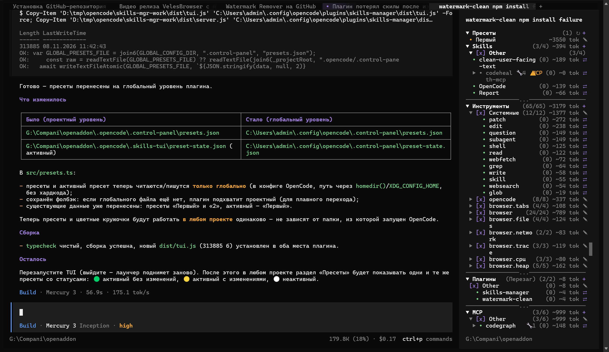

# Dazhdbog (Даждьбог) — OpenCode plugin

**[English](README.md) | [Русский](README.ru.md)**

---



## What is it

**Dazhdbog** is a TUI plugin for **OpenCode v2** that gives you full control over your workspace from a single sidebar panel: skills, tools, MCP servers and plugins — with current state, one-click toggles, **sets** and **presets** for applying whole configurations instantly.

### Features

- **Sidebar panel** — everything OpenCode can load in one place:
  - **Skills** — all skills of the current project and global config: enabled/disabled state, loading state (loaded skills are highlighted green on top), estimated token consumption;
  - **Tools** — every tool (write, edit, shell, subagent, MCP tools, …): enable/disable rules, usage counters, token estimates;
  - **MCP servers** — server catalog: status (connected / auth required / disabled), enable/disable per server, grouping by class;
  - **Plugins** — loaded plugins with toggles and status.
- **One-click toggles** — enable/disable any skill, tool, MCP server or plugin without editing config files by hand; the plugin writes the proper rules/settings for you.
- **Usage counters** — per-skill and per-tool statistics show what actually consumes context.
- **Sets** — group skills into named sets and apply them instantly; state is persisted across restarts.
- **Presets** — save a full configuration (skills + tools + plugins + MCP) and apply it with a single click.
- **Status indicators** — a dot next to an item shows its state:
  - 🟢 green — active / connected (e.g. active preset without changes);
  - 🟡 yellow — warning (preset modified, MCP requires auth, timeout);
  - 🔴 red — error (MCP server failed to connect, applying failed);
  - ⚪ gray — disabled / inactive.
- **Russian descriptions** — built-in dictionary translates skill/tool/server/plugin names into Russian.
- **Works locally** — all state lives in `.opencode/.skills-tui`, no cloud, no telemetry.

## Installation

**By an agent (automated, via git):**

```bash
git clone --depth 1 https://github.com/Leylin007/opencode-dazhdbog.git /tmp/dazhdbog
mkdir -p ~/.config/opencode/plugins/dazhdbog
cp -r /tmp/dazhdbog/{index.ts,tui.tsx,build.ts,package.json,dist} ~/.config/opencode/plugins/dazhdbog/
opencode service restart
```

Windows agent (PowerShell):

```powershell
$src = "$env:TEMP\dazhdbog"
$dst = Join-Path $env:USERPROFILE ".config\opencode\plugins\dazhdbog"
git clone --depth 1 https://github.com/Leylin007/opencode-dazhdbog.git $src
New-Item -ItemType Directory -Force $dst | Out-Null
Copy-Item "$src\index.ts","$src\tui.tsx","$src\build.ts","$src\package.json" $dst -Force
Copy-Item "$src\dist" $dst -Recurse -Force
opencode service restart
```

> Note for agents: after restart the plugin is discovered automatically from `~/.config/opencode/plugins/`. **Do not register it in `cli.json`** — adding the name there makes OpenCode try to install it as an npm package.

**Manually:**

```bash
git clone --depth 1 https://github.com/Leylin007/opencode-dazhdbog.git
cp -r opencode-dazhdbog ~/.config/opencode/plugins/dazhdbog
opencode service restart
```

**Simplest (whole repo is the plugin folder):**

```bash
git clone --depth 1 https://github.com/Leylin007/opencode-dazhdbog.git ~/.config/opencode/plugins/dazhdbog
opencode service restart
```

After the restart, open the sidebar — the Dazhdbog panel appears automatically.

## Reference projects (thanks!)

This plugin was built with heavy inspiration from three great open-source OpenCode plugins — many thanks to their authors:

- **[MCPClassify](https://github.com/StandarterDF/MCPClassify_OCV2)** — MCP tree in the sidebar grouped by classes (MCP → Class → servers) with click toggles instead of a flat list; collapse state is remembered, the default section is suppressed via a directive in `cli.json`.
- **[opencode-skills-tui](https://github.com/aihaipeng/opencode-skills-tui)** — TUI plugin: Skills section in the right sidebar, loaded skills highlighted green on top, usage counters via `/skills-stats`, reading `SKILL.md` on right-click.
- **[skill-switch](https://github.com/hatappo/skill-switch)** — TUI skill switcher between agents: toggles via `permission.skill` in `opencode.json` (deny/allow without renaming folders), install/uninstall from one table.

## Author's other projects

- **[Veles](https://velesbrowser.com)** — cinema browser for Windows: your own picture, sound mixer and video recording.
- **[Perun](https://svarog.tech/#/product/perun-guard)** — Android guard: camera & microphone activity monitor, fully offline.
- **[Stribog](https://svarog.tech/#/product/stribog)** — screen recorder for Windows, 2K with a subscription.

## License

MIT — see [LICENSE](LICENSE).
