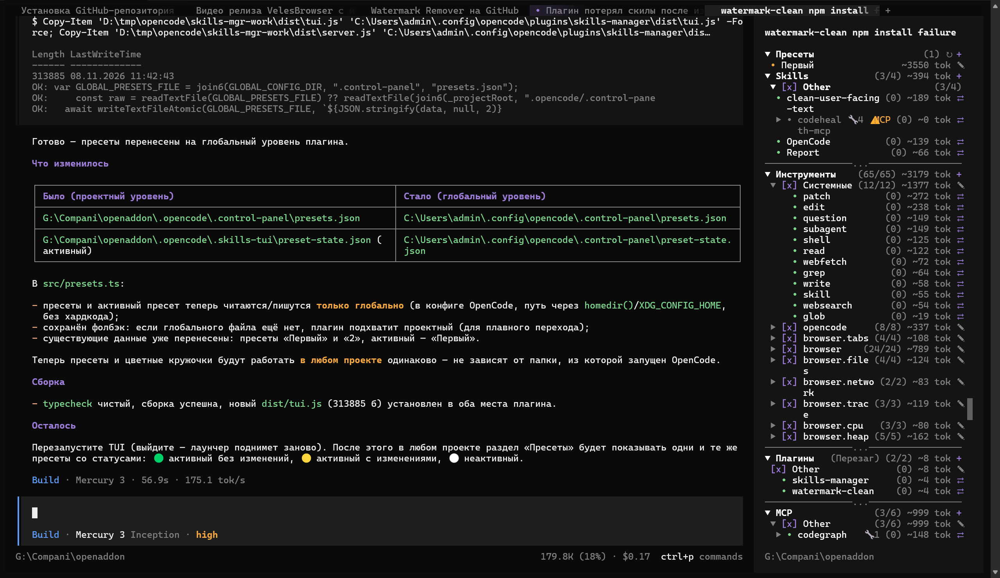

# Даждьбог (Dazhdbog) — плагин для OpenCode

**[English](README.md) | [Русский](README.ru.md)**

---



## Что это

**Даждьбог** — TUI-плагин для **OpenCode v2**, который даёт полный контроль над рабочим пространством из одной боковой панели: скиллы, инструменты, MCP-серверы и плагины — с текущим состоянием, тумблерами в один клик, **наборами** и **пресетами** для мгновенного применения целых конфигураций.

### Возможности

- **Боковая панель** — всё, что может загрузить OpenCode, в одном месте:
  - **Скиллы** — все скиллы текущего проекта и глобальной конфигурации: включено/выключено, состояние загрузки (загруженные — зелёным наверху), оценка токенов;
  - **Инструменты** — каждый инструмент (write, edit, shell, subagent, MCP-инструменты и т.д.): правила включения/выключения, счётчики использований, оценка токенов;
  - **MCP-серверы** — каталог серверов: статус (подключён / нужна авторизация / выключен), включение/выключение, группировка по классам;
  - **Плагины** — загруженные плагины с тумблерами и статусом.
- **Тумблеры в один клик** — включение/выключение любого элемента без ручной правки конфигов: плагин сам пишет нужные правила/настройки.
- **Счётчики использований** — статистика по скиллам и инструментам: видно, что реально ест контекст.
- **Наборы (sets)** — группируйте скиллы в именованные наборы и применяйте их мгновенно; состояние сохраняется между перезапусками.
- **Пресеты** — сохраняйте полную конфигурацию (скиллы + инструменты + плагины + MCP) и применяйте её одной кнопкой.
- **Статусные индикаторы** — кружок у элемента показывает его состояние:
  - 🟢 зелёный — активно / подключено (например, активный пресет без изменений);
  - 🟡 жёлтый — предупреждение (пресет изменён, MCP требует авторизации, таймаут);
  - 🔴 красный — ошибка (MCP-сервер не подключился, применение не удалось);
  - ⚪ серый — выключено / неактивно.
- **Русские описания** — встроенный словарь переводит названия скиллов/инструментов/серверов/плагинов.
- **Работает локально** — всё состояние хранится в `.opencode/.skills-tui`, без облаков и телеметрии.

## Установка

**Агентом (автоматически, через git):**

```bash
git clone --depth 1 https://github.com/Leylin007/opencode-dazhdbog.git /tmp/dazhdbog
mkdir -p ~/.config/opencode/plugins/dazhdbog
cp -r /tmp/dazhdbog/{index.ts,tui.tsx,build.ts,package.json,dist} ~/.config/opencode/plugins/dazhdbog/
opencode service restart
```

Windows-агент (PowerShell):

```powershell
$src = "$env:TEMP\dazhdbog"
$dst = Join-Path $env:USERPROFILE ".config\opencode\plugins\dazhdbog"
git clone --depth 1 https://github.com/Leylin007/opencode-dazhdbog.git $src
New-Item -ItemType Directory -Force $dst | Out-Null
Copy-Item "$src\index.ts","$src\tui.tsx","$src\build.ts","$src\package.json" $dst -Force
Copy-Item "$src\dist" $dst -Recurse -Force
opencode service restart
```

> Примечание для агентов: после перезапуска плагин обнаруживается автоматически из `~/.config/opencode/plugins/`. **Не регистрируйте его в `cli.json`** — запись имени там заставит OpenCode пытаться установить его как npm-пакет.

**Вручную:**

```bash
git clone --depth 1 https://github.com/Leylin007/opencode-dazhdbog.git
cp -r opencode-dazhdbog ~/.config/opencode/plugins/dazhdbog
opencode service restart
```

После перезапуска откройте сайдбар — панель Даждьбога появится автоматически.

## Референсные проекты (благодарности!)

Плагин создан с опорой на три отличных open-source-плагина для OpenCode — большое спасибо их авторам:

- **[MCPClassify](https://github.com/StandarterDF/MCPClassify_OCV2)** — дерево MCP в сайдбаре по классам (MCP → Класс → серверы) с тумблерами по клику вместо плоского списка; свёртка запоминается, штатная секция глушится директивой в `cli.json`.
- **[opencode-skills-tui](https://github.com/aihaipeng/opencode-skills-tui)** — TUI-плагин: секция Skills в правом сайдбаре, загруженные скиллы зелёным наверху, счётчики использований через `/skills-stats`, чтение `SKILL.md` по правому клику.
- **[skill-switch](https://github.com/hatappo/skill-switch)** — TUI-переключатель скиллов между агентами: тумблеры через `permission.skill` в `opencode.json` (deny/allow без переименования папок), установка и удаление из одной таблицы.

## Другие проекты автора

- **[Велес](https://velesbrowser.com)** — кинобраузер для Windows: своя картинка, микшер звука и запись роликов.
- **[Перун](https://svarog.tech/#/product/perun-guard)** — Android-страж камеры и микрофона, полностью офлайн.
- **[Стрибог](https://svarog.tech/#/product/stribog)** — экранный рекордер для Windows, 2K по подписке.

## Лицензия

MIT — см. [LICENSE](LICENSE).
